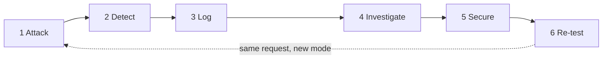

# WebSecLab

**A web-based attack detection, prevention and forensic analysis platform.**

Three deliberately vulnerable labs sit inside an otherwise hardened Express
application. Every attack is detected by a transparent rule set, scored, logged,
investigated, exported as a hashed evidence package — and then re-tested against
the same request once the protection is switched on.

Built as a university **Cyber Forensics & Laws** assignment. Runs entirely on
`localhost` against seeded fictional data.


> **Educational use only.** The intentional weaknesses exist *only* inside the
> three lab routes and *only* while the global mode is `VULNERABLE`. Nothing here
> targets a third-party system.



---

## Contents

- [What it is](#what-it-is)
- [Features](#features)
- [Stack](#stack)
- [How it fits together](#how-it-fits-together)
- [Getting started](#getting-started)
- [Demo accounts](#demo-accounts)
- [The three labs](#the-three-labs)
- [Detection and scoring](#detection-and-scoring)
- [Forensics and evidence](#forensics-and-evidence)
- [Interface](#interface)
- [Tests](#tests)
- [Project layout](#project-layout)
- [Documentation](#documentation)
- [Troubleshooting](#troubleshooting)
- [Security posture](#security-posture)
- [Legal and ethical note](#legal-and-ethical-note)

---

## What it is

Most teaching projects stop at "here is a vulnerable page". This one keeps going:
the vulnerable part is small and quarantined, and the substance is everything
that *watches* it.

| Stage | What happens | Where |
|---|---|---|
| **Attack** | A payload is sent to one of three lab routes | `src/controllers/{sql,xss,idor}Controller.js` |
| **Detect** | Nine regex rules run **on response finish**, so detection can never alter a response | `src/security/detectors`, `src/middleware/securityMonitor.js` |
| **Log** | The attempt is scored and written as a security event, with allowlist-redacted request evidence | `src/security/riskCalculator.js`, `securityLogger.js` |
| **Investigate** | Per-incident page: summary, sanitized evidence, timeline, mitigation map | `src/controllers/forensicsController.js` |
| **Secure** | One global `SAFE` / `VULNERABLE` switch closes the hole for the *next* request | `src/middleware/securityMode.js` |
| **Re-test** | The byte-identical request is replayed in `SAFE` mode and compared | [`docs/ATTACK_DEMOS.md`](docs/ATTACK_DEMOS.md) |

Everything the defender sees is a real row in PostgreSQL — no mocked data, no
hard-coded dashboard numbers.

---

## Features

| Area | State |
|---|---|
| Auth — bcrypt cost 11, session regeneration, one generic failure message | complete |
| Three labs: SQL injection, XSS, IDOR | complete |
| Global `SAFE` / `VULNERABLE` mode — ADMIN switch in the top bar, read from the DB on every request | complete |
| Detection — 9 rules, risk scoring, severity bands | complete |
| Security event log — filters, free-text search, pagination | complete |
| Forensic investigation page, timeline, mitigation map | complete |
| Evidence export, SHA-256, download, verify pass/fail | complete |
| Dashboard — metrics and two Chart.js charts | complete |
| Least-privilege database role for the vulnerable query | complete |
| Light / dark / system theme — server-rendered, no flash, no inline script | complete |
| Responsive shell — off-canvas drawer below 900 px | complete |
| Unit tests + 26-check end-to-end acceptance suite | complete |

---

## Stack

**Node.js** (≥18) · **Express 4** · **EJS** · **Bootstrap 5** · vanilla JS ·
**Chart.js** · **PostgreSQL 13+** (`pg`) · `bcrypt` · `express-session` ·
`express-validator` · `helmet` · `express-rate-limit` · Node `crypto`.

A monolith. No React, no Docker, no message queue, no ORM. Bootstrap and Chart.js
are served from `node_modules` through `/vendor` — **no CDN**, so the app works
offline and the strict Content-Security-Policy stays simple.

---

## How it fits together

The contracted middleware order (`src/app.js`) — the order is load-bearing, so it
is asserted by the acceptance suite:

```
helmet (strict CSP)
→ static: /public, /vendor/bootstrap, /vendor/chart.js
→ body parsers
→ session (httpOnly, sameSite=lax, secure only in production)
→ CSRF token issued
→ locals defaults  →  flash  →  currentPath
→ loadUser
→ loadSecurityMode      read from the database on EVERY request, never cached
→ verifyCsrf            every unsafe method, sign-out and the mode switch included
→ XSS-lab CSP override  /labs/xss only, VULNERABLE only
→ securityMonitor       res.on('finish') — logging can never change a response
→ routes → 404 → error handler
```

The division of labour is deliberate:

- **Blocking** happens in the **controller** — the only place that can still
  change the response.
- **Logging** happens in the **monitor**, after the response is finished, wrapped
  in `try/catch` so a monitoring failure can never break a request.
- **Rate limiting** applies to `/login` and `/register` only. `/labs/*` is
  unlimited on purpose, so Burp Repeater/Intruder loops keep working.

---

## Getting started

**Prerequisites:** Node ≥18 and a local PostgreSQL 13+ with a superuser you can
use for one setup step.

```bash
git clone <your-fork-url> webseclab
cd webseclab
npm install

cp .env.example .env      # then fill in the 5 variables below
npm run db:reset          # creates both roles, the schema and the seed data
npm run dev               # nodemon, or: npm start
```

Open <http://localhost:3000>.

### Environment variables

| Variable | Purpose |
|---|---|
| `PORT` | listening port (default `3000`) |
| `NODE_ENV` | `development` or `production` |
| `DATABASE_URL` | application role — owns the schema, runs every non-lab query |
| `LAB_DATABASE_URL` | least-privilege `lab_reader` role, used **only** by the vulnerable SQLi query |
| `SESSION_SECRET` | session signing secret — generate with `node -e "console.log(require('crypto').randomBytes(32).toString('hex'))"` |
| `ADMIN_DATABASE_URL` | superuser URL used **only** by `npm run db:reset`; never used by the running app |
| `RESIDUAL_RISK_RATE` | optional. Share of `SAFE`-mode attempts in which the controls deliberately do not engage (`0` = off, the default). See [Residual risk](#residual-risk) |

`.env` is gitignored. Never commit it, and never commit `exports/*.json`.

### Residual risk

By default the global mode decides every result, which is what the scripted
demonstration needs: the same request sent in both modes must give opposite
answers. A real operations view never looks that tidy, so the outcome model can
be turned on to give the log a minority tail in the dangerous direction:

```bash
# roughly one attempt in eight slips through SAFE
RESIDUAL_RISK_RATE=0.12 npm start
```

It weakens the **application**, never the **record**: a gapped SQLi attempt really
runs the concatenated query, a gapped XSS attempt really renders unescaped with
the route policy relaxed in the same response, and a gapped IDOR attempt really
returns the foreign document with HTTP 200. Input validation is never gapped, and
every affected event stores `outcomeBasis: 'RESIDUAL_RISK'` — visible as a
*residual risk* badge in the events table and an **Outcome basis** row on the
incident page. Nothing is inserted into the audit trail out of thin air.

Keep the rate at `0` (the default) while recording the demonstration and while
running `npm run test:acceptance`, whose exact-outcome checks assume the mode
decides; check 25 fails loudly if the running server has it enabled.

### Database scripts

| Command | Effect |
|---|---|
| `npm run db:reset` | drop + recreate the database, apply the schema, seed everything |
| `npm run db:reset -- --keep-database` | re-apply schema and seeds without dropping |
| `npm run db:seed` | re-seed only — also resets the demo passwords |

`db:reset` creates the two database roles **from the URLs in `.env`**, so the
credentials in the file and in PostgreSQL cannot drift apart. Password hashes are
produced by bcrypt at seed time — no hash is ever committed.

---

## Demo accounts

Local, fictional accounts. `npm run db:seed` resets these passwords.

| Role | Email | Password | Can do |
|---|---|---|---|
| ADMIN | `admin@webseclab.local` | `Admin-Lab-Demo-2026` | move the global switch, dashboard, events, forensics, evidence |
| USER | `alice@webseclab.local` | `User-Lab-Demo-2026` | run the labs, own 4 documents |
| USER | `bob@webseclab.local` | `User-Lab-Demo-2026` | same as Alice — the IDOR target account |

Override with `SEED_ADMIN_PASSWORD` / `SEED_USER_PASSWORD` in `.env`. The login
page has a **Use** button per account that fills the form.

Seed data: 12 products (9 released, 3 unreleased — the "hidden data" demo) ·
7 documents across the two users (ids sequential **on purpose**) · 3 comments.

---

## The three labs

| Lab | Route | `VULNERABLE` | `SAFE` | Result recorded |
|---|---|---|---|---|
| **SQL injection** | `GET /labs/sql?q=` | term concatenated into the `WHERE` clause; hidden rows appear | bound parameter `$1`, validated ≤50 chars | `SUCCESSFUL` 100 → `NEUTRALIZED` 85 |
| **XSS** (stored) | `GET /labs/xss`, `POST /labs/xss/comments` | stored raw, rendered unescaped, CSP relaxed on that route | stored raw, rendered escaped, strict CSP | `SUCCESSFUL` 90 → `NEUTRALIZED` 75 |
| **IDOR** | `GET /labs/idor/documents/:id` | no ownership check — another user's document is returned | ownership check → HTTP 403, content withheld | `SUCCESSFUL` 95 → `BLOCKED` 80 |

Payloads worth having to hand:

| Purpose | Payload |
|---|---|
| SQLi — tautology (exposes the 3 unreleased rows) | `' OR 1=1--` |
| SQLi — reach for another table (refused by `lab_reader`) | `' UNION SELECT 1,email,password_hash,'1','x' FROM users--` |
| XSS — script tag | `<script>alert(document.domain)</script>` |
| XSS — event handler | `` |
| IDOR | change the integer id in `/labs/idor/documents/<id>` |

Two details worth knowing before a viva:

1. **The XSS comment is stored once.** Switching the mode does not touch the
   database — only the rendering. That is why the same stored comment executes in
   `VULNERABLE` mode and shows as inert text in `SAFE` mode, and why the re-test
   is a real re-test rather than a diff.
2. **Even in `VULNERABLE` mode the SQLi query cannot reach `users`.** It runs as
   `lab_reader`, which holds `SELECT` on `products` and nothing else. A
   `UNION SELECT … FROM users` payload is refused by the database and logged as
   `BLOCKED`: the weakness is preserved, the blast radius is not.

**Click-by-click demonstration steps for each attack are in
[`docs/ATTACK_DEMOS.md`](docs/ATTACK_DEMOS.md)** — one owner per attack, with the
expected on-screen result and the security-event values for every step.

---

## Detection and scoring

Nine regex rules run on response finish, **first match wins**:

| Rule | Attack type | Matches |
|---|---|---|
| `SQLI_UNION_SELECT` | SQL_INJECTION | `union (all) select` |
| `SQLI_STACKED_QUERY` | SQL_INJECTION | `;` followed by `drop`/`insert`/`update`/`delete`/`select` |
| `SQLI_TAUTOLOGY` | SQL_INJECTION | `' or 1=1`-style tautologies |
| `SQLI_COMMENT_TERMINATOR` | SQL_INJECTION | a quote followed by `--`, `#` or `/*` |
| `XSS_SCRIPT_TAG` | XSS | `<script` |
| `XSS_EVENT_HANDLER` | XSS | `<tag on…=` |
| `XSS_JS_URI` | XSS | `javascript:` |
| `XSS_HTML_INJECTION` | XSS | `-<stamp>.json`, records `EVIDENCE_EXPORTED` |
| `GET /forensics/:uuid/evidence/:filename` | downloads the exact bytes that were hashed |
| `GET`/`POST /forensics/verify` | re-hashes an uploaded file and reports match / mismatch |

The evidence package is serialized with a **fixed key order** and
`JSON.stringify(obj, null, 2)`; those exact bytes are hashed and written, and the
SHA-256 is recorded in `incident_actions` **outside** the file.

**Timeline, honest by construction.** Only two real timestamps exist — the
event's `occurred_at` and the `INVESTIGATION_OPENED` action — so stages 1–4 share
one timestamp and the page says so in plain text. We chose an honest single
timestamp over inventing four.

> **Disclaimer, shown on every page that displays a hash:** SHA-256 demonstrates
> whether the exported file has changed. Hashing by itself does not establish
> authenticity or a complete chain of custody.

---

## Interface

### Light / dark / system theme

A segmented control in the top bar switches between **Light**, **Dark** and
**System**. The choice lives in a readable `ws_theme` cookie and is resolved
**server-side on every request**, so the `<html>` element already carries
`data-theme="dark"` in the first byte of HTML — no flash of the wrong palette,
and no inline script (the CSP forbids inline script outside the XSS lab).

- `public/css/tokens.css` holds the whole palette as semantic tokens: primitives,
  then the light block, then the dark block. Components never hard-code a colour.
- `System` renders **no** `data-theme` attribute and lets
  `@media (prefers-color-scheme: dark)` decide, so it follows the OS live.
- `public/js/theme.js` only writes the cookie and the attribute, and dispatches a
  `themechange` event; the charts listen for it and rebuild from the same tokens
  instead of keeping stale colours.
- `prefers-reduced-motion: reduce` kills every transition; the print stylesheet
  forces the light palette whatever the screen theme is.

### Responsive shell

| Width | Behaviour |
|---|---|
| `> 900px` | sidebar is a sticky column beside the content |
| `≤ 900px` | sidebar becomes an off-canvas drawer, opened from the top bar |
| `≤ 700px` | the top bar takes a second row |
| `≤ 560px` | metric cards and control labels collapse |

The drawer is keyboard reachable (`aria-expanded`, `Escape`, backdrop, focus
return). Wide tables scroll inside their own card, so the page itself never
scrolls sideways. Acceptance checks 22–24 pin the toggle markup, the CSS cascade
order that makes the responsive rules actually win, and the full-height sidebar
rail.

---

## Tests

```bash
npm test                     # detectors + risk + outcome model — no server needed
npm run test:detectors       # 37 detector cases
npm run test:risk            # the six contract score rows + severity bands
npm run test:outcome         # 9 residual-risk outcome model cases
npm run test:acceptance      # 26 end-to-end checks against a running server
```

The acceptance suite drives the real HTTP interface with its own cookie jar:

```bash
npm run dev                       # one terminal
npm run test:acceptance           # another
node scripts/acceptance.js 6 12   # run only checks 6 and 12
```

It covers the contracted guarantees: bcrypt-only passwords, the `SAFE` default,
USER rejected on every admin route, the exact score table, credential-free logs
and evidence, the single unescaped render, the isolated unsafe SQL function, the
least-privilege role, the full lifecycle of all three labs in both modes, CSRF
rejection, the XSS-route-only CSP relaxation, evidence export/download/verify
(pass **and** fail), survival with an unreachable database, dashboard numbers
matching raw `SELECT count(*)`, the server-rendered theme, the responsive
cascade order, and every copy button on the lab pages pointing at something real.

It restores the global mode to `SAFE` when it finishes and deletes the live
`<script>` comment it stored — left behind, that payload would fire `alert()` on
every `VULNERABLE`-mode page view. It leaves behind the events and evidence it
generated, which is the audit trail of the test. Run `npm run db:reset` for a
clean database before recording a demo.

### Demo traffic

A database that has only ever seen hand-made requests looks like exactly that.
This drives the real HTTP interface with a varied set of payloads, accounts and
user agents, so the events table, the dashboard charts and the forensic console
have realistic activity to show:

```bash
npm run demo:traffic           # 21 recorded attacks + 6 benign requests
npm run demo:traffic -- --dry  # print the plan, send nothing
```

Every row it produces is a **genuine record**: the request is really sent, the
detector really runs, the score is really calculated and the monitor really
writes the row. It deliberately never inserts invented rows — fabricated rows
with invented timestamps and source addresses would be fabricated evidence in an
audit log, which is the one thing a forensics demo cannot afford. The honest
consequences are stated in the script header: `source_ip` stays the loopback
address (the truth for a local lab) and the timestamps are the real time you run
it, so the 14-day chart fills in around now rather than across the past.

It deletes the live `<script>` comments it posted on the way out — left behind,
they fire `alert()` on every `VULNERABLE`-mode page view — and leaves the global
mode on `SAFE`. Exit status is 0 only when every scenario produced the event it
predicted, so a failed run tells you which payload stopped matching its rule.

---

## Project layout

```
src/
  app.js                     express wiring, the contracted middleware order
  server.js                  entry point, graceful shutdown
  config/                    env validation, the two connection pools
  middleware/                auth, security mode, CSRF, flash, rate limit, CSP, monitor, theme, errors
  security/                  sanitizer, detectors, risk, result mapping, logger, evidence
  controllers/               auth, sql, xss, idor, admin, dashboard, security, forensics
  services/                  read-side queries (events, dashboard aggregates)
  labs/                      lab page copy, protection status, comparison tables
  routes/                    one router per area
views/                       EJS pages + partials (include-based layout)
public/css/tokens.css        primitives + the light and dark token blocks
public/css/app.css           the design system, on top of Bootstrap
public/js/                   theme toggle, drawer, charts, evidence verification
database/                    schema.sql, seed.js (runtime-hashed users), seed.sql, reset.js
scripts/                     test-detectors.js, test-risk.js, acceptance.js, demo-traffic.js
docs/                        contracts, report, demo scripts, Burp procedure
exports/                     generated evidence packages (gitignored)
```

---

## Documentation

| Document | What it is for |
|---|---|
| [`docs/MEMBER_SCRIPTS.md`](docs/MEMBER_SCRIPTS.md) | **Word-for-word presenter script for each member**, with word counts and pace |
| [`docs/ATTACK_DEMOS.md`](docs/ATTACK_DEMOS.md) | **Click-by-click steps for each attack, one owner per member** |
| [`docs/CONTRACTS.md`](docs/CONTRACTS.md) | Frozen interface: schema, middleware order, scores, rules, formats |
| [`docs/DEMO_SCRIPT_10MIN.md`](docs/DEMO_SCRIPT_10MIN.md) | 9:45 presenter script — one attack per member |
| [`docs/DEMO_SCRIPT.md`](docs/DEMO_SCRIPT.md) | 7:30 presenter script — single runbook |
| [`docs/BURP_STEPS.md`](docs/BURP_STEPS.md) | Burp Suite procedure and copy-paste payloads |
| [`docs/REPORT.md`](docs/REPORT.md) | Report outline and the screenshot checklist |

---

## Troubleshooting

| Symptom | Cause and fix |
|---|---|
| `Missing required environment variable` | `.env` absent or incomplete — start from `.env.example` |
| `password authentication failed for user "postgres"` during `db:reset` | `ADMIN_DATABASE_URL` has the wrong superuser password |
| `EADDRINUSE` | another process holds the port — change `PORT` or stop the other server |
| Sign-in silently never sticks | `NODE_ENV=production` on `http://localhost` makes the cookie `secure` — use `development` |
| `bcrypt` fails to build on a teammate's machine | `npm i bcryptjs`, then change the one `require` in `src/security/password.js` — the hash format is identical |
| Burp sees no localhost traffic | use Burp's built-in browser, browse `http://127.0.0.1:3000`, or set `network.proxy.allow_hijacking_localhost = true` in Firefox |
| The XSS payload does not execute | check the mode is `VULNERABLE` — the relaxed CSP applies only to `/labs/xss` in that mode |
| The dashboard is full of old events | previous runs and test suites leave an audit trail — `npm run db:reset` |

---

## Security posture

True in **both** modes — this is the part that never gets switched off:

| Area | Setting |
|---|---|
| Helmet | on, strict CSP, `upgrade-insecure-requests` disabled for the local http demo |
| Session | `httpOnly`, `sameSite=lax`, `secure` only in production, `regenerate()` on sign-in |
| CSRF | per-session token on every unsafe method, including sign-out and the mode switch |
| Passwords | bcrypt cost 11, stored hash only at seed time, one generic failure message |
| Validation | `express-validator` on register, login, comment, search and `:id` |
| Errors | central handler; stack traces only when `NODE_ENV !== production` |
| Rate limiting | `/login` and `/register` only |
| Logging | `request_data` allowlist + recursive redaction (`pass`/`token`/`cookie`/…) |
| Database | the vulnerable query runs as `lab_reader` — `SELECT` on `products`, nothing else |
| Resilience | a database outage degrades to sign-out and `SAFE` instead of crashing |

Intentionally weakened in `VULNERABLE` mode, and nowhere else: the SQLi query
construction, the XSS output encoding, the XSS route's CSP, and the IDOR
ownership check.

---

## Legal and ethical note

This project exists to teach how injection, cross-site scripting and broken
access control work — and how detection, logging and forensic evidence fit
together. It ships its own vulnerable code **precisely so that no third-party
system is ever a target**.

- Run it only on your own machine, on `localhost`.
- Never point the payloads in this repository at a system you do not own or do
  not have explicit written permission to test.
- The seeded data is fictional. Do not load real personal data into it.
- The evidence hash demonstrates file integrity only — it is not a chain of
  custody and does not establish authenticity.

No open-source licence is granted; this is a coursework artefact.

---

## Contributors

| Member | Owned areas |
|---|---|
| **M1** — core, auth, SQLi | app wiring, database, authentication, SQL injection lab, dashboard queries, hardening |
| **M2** — UI, XSS, IDOR | views, design system, XSS and IDOR labs, dashboard, client-side JS |
| **M3** — detection, forensics | detectors, risk model, security monitor, event log, forensics, evidence, tests |
